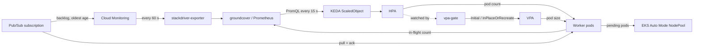
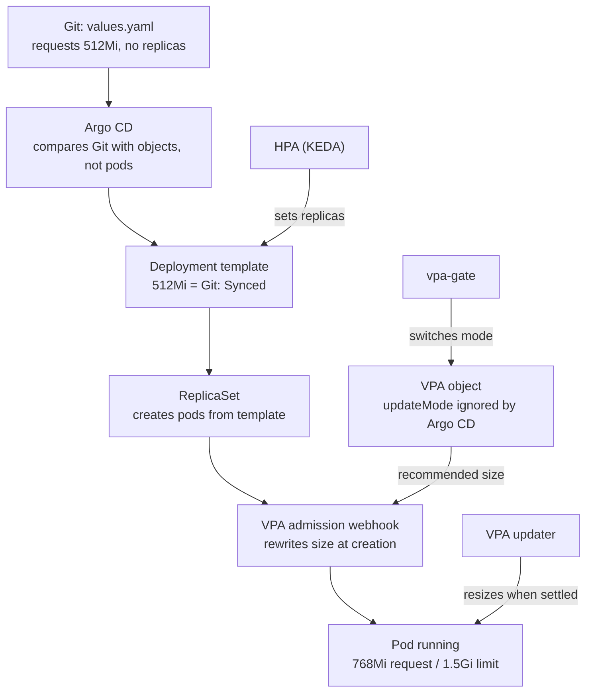

# Pub/Sub worker autoscaling on EKS Auto Mode: design

Pub/Sub consumer pods scale on **queue backlog, not CPU**. KEDA reads queue
metrics from groundcover (or an in-cluster Prometheus) and drives the HPA, which
owns the **pod count**. VPA owns the **pod size**, and the small `vpa-gate`
controller lets it resize running pods only when the HPA is quiet. EKS Auto Mode
adds and removes nodes. Everything ships from Git through Argo CD.

Companion docs: [RUNBOOK.md](RUNBOOK.md) (rollout steps) ·
[../loadtest/README.md](../loadtest/README.md) (stress testing) ·
[../README.md](../README.md) (deploy).

---

## 1. Architecture

| Component | Owns | Where |
| --- | --- | --- |
| KEDA + HPA | Number of worker pods | `01-keda-auth.yaml`, `02-scaledobject.yaml` |
| VPA | CPU/memory of each pod | `06-vpa.yaml`, installed by `argocd/apps/vpa.yaml` |
| vpa-gate | When VPA may resize running pods | `controller/`, `charts/vpa-gate/` |
| EKS Auto Mode | Nodes (Spot first) | `03-nodepool.yaml` |
| Placeholder pods | Instant headroom | `04-overprovisioning.yaml` |
| Argo CD | Everything in Git | `argocd/` |

---

## 2. How queue metrics become a pod count

Each KEDA trigger asks for **metric ÷ target per pod** pods (rounded up). KEDA
uses the **highest** of the three; the result is held between **2 and 100**.

| Trigger | Metric | Target per pod | Catches | Status |
| --- | --- | --- | --- | --- |
| Backlog | Undelivered messages (published, not yet acked, incl. pulled but unfinished) | 20 | Volume | In the repo |
| Oldest message | Age of the oldest unacked message (s) | 60 s | A few stuck/slow messages | In the repo |
| In-flight | Messages workers are processing now (worker metric) | 16 (80% of flow control 20) | Saturation, seconds before the backlog metric moves | Designed; needs the worker metric |

The age trigger is deliberately weak (200 s asks for only 4 pods): stuck
messages are not a capacity problem, so they go to the dead-letter topic.

**Worked examples**

| Moment | Backlog | Oldest | In-flight | Backlog → pods | Age → pods | In-flight → pods | KEDA asks for |
| --- | --- | --- | --- | --- | --- | --- | --- |
| Quiet | 30 | 5 s | 10 | 2 | 1 | 1 | **2** (min) |
| Spike detected | 800 | 40 s | 40 | 40 | 1 | 3 | **40** |
| First 1-3 min of a spike (backlog metric lagging), 10 pods full | 150 | 30 s | 200 | 8 | 1 | 13 | **13** (in-flight leads) |
| A few stuck messages | 60 | 200 s | 30 | 3 | 4 | 2 | **4** |
| Huge spike | 5,000 | 90 s | 2,000 | 250 | 2 | 125 | **100** (max) |
| Drained | 20 | 3 s | 5 | 1 | 1 | 1 | **2**, reached gradually |

**HPA behaviour:** up immediately (at most +100% or +10 pods per 15 s); down
only after 5 minutes of lower demand (at most -20% per minute). If metrics
cannot be read 3 times in a row it holds **10** pods (fallback).

---

## 3. How HPA, VPA and Argo CD work together

HPA owns the pod count and always wins. VPA owns pod size but only touches
**running** pods when HPA is quiet. Argo CD owns Git and never sees per-pod sizes.

| What | Owner | Why nobody fights over it |
| --- | --- | --- |
| Pod count | HPA (KEDA) | `replicas` is not in Git |
| Pod CPU and memory | VPA | Applied to pods, not the Deployment template; Argo CD doesn't diff pods |
| VPA `updateMode` | vpa-gate | Argo CD `ignoreDifferences` on this one field |
| Everything else | Git via Argo CD | Normal GitOps |

**Priority:** HPA first (adding pods never disrupts running ones). VPA gives way
while HPA is busy. Planned exception: OOM override (fix an OOMing pod even during
a spike), not built yet.

### The VPA gate

| HPA state | VPA mode | What happens |
| --- | --- | --- |
| Scaled in the last 15 minutes, or still scaling | `Initial` | New pods get the recommended size; running pods aren't touched |
| No scaling for 15 minutes | `InPlaceOrRecreate` | Running pods are resized; on Kubernetes 1.33+ in place, without a restart |

- Watches HPAs: switches to `Initial` within seconds of scaling; re-checks
  exactly when the 15-minute window ends (no polling).
- Opt-in per VPA (annotations in Git): `pubsub-autoscaling/vpa-gate: enabled`,
  `hpa-name`, `stable-seconds`.
- Every switch: Kubernetes Event `UpdateModeChanged`, JSON log, metrics
  `vpa_gate_settled`, `vpa_gate_mode_switches_total`.
- Leader election (2 replicas safe), dry run, least-privilege RBAC.

### When VPA acts

| VPA part | When | What |
| --- | --- | --- |
| Recommender | Always, every minute (even `Off`) | Learns CPU/memory use |
| Admission webhook | Every pod creation (`Initial`, `InPlaceOrRecreate`) | Sets the new pod's size |
| Updater | Only `InPlaceOrRecreate` (HPA quiet 15 min), every minute | Resizes running pods: within ~1 min if outside the recommended range; otherwise only if 12 h old and >10% off |

When usage is normal and sizes are right, VPA does nothing, even in `InPlaceOrRecreate`.

### Restarts

- `Off` and `Initial` never restart pods.
- `InPlaceOrRecreate`: in place on Kubernetes 1.33+ (no restart); only if that
  is impossible is the pod recreated, at most 20% at a time (PDB).
- Not caused by VPA: OOM kills (kubelet restarts the container), HPA
  scale-down, node consolidation; all graceful.
- Apps that read their memory limit only at start: `resizePolicy` memory `RestartContainer`.

### Mixed pod sizes are normal

During a spike new pods get the new size; old pods keep theirs. Scale-down
usually removes the newest pods first, so the long-lived old pods are the ones
the settled phase fixes.

### OOM handling

1. Container is killed and restarted in the same pod; unacked messages are redelivered.
2. VPA raises memory by 20% (at least 100Mi); with `RequestsAndLimits` the limit rises too.
3. HPA quiet: a pod that OOMed within 10 min of starting is fixed right away.
   HPA busy: only new pods get more memory (OOM override planned).
4. A message that always causes OOM reaches the dead-letter topic.

### What the chart's values.yaml resources are for

The starting size before VPA has data; the fallback if VPA's webhook is down
(it fails open); and the source of the VPA floor (`minAllowed`).

---

## 4. Scenario playbook

| Scenario | HPA (pod count) | VPA mode | What VPA does | Notes |
| --- | --- | --- | --- | --- |
| Steady, quiet traffic | Holds 2 | `InPlaceOrRecreate` | Nothing if sizes are right; small in-place fixes after 12 h | |
| Traffic spike | Up to 100, doubling every 15 s | `Initial` within seconds | Sizes each new pod; running pods untouched | Placeholders give instant room; Auto Mode adds nodes |
| Draining after a spike | -20%/min after 5 min | `Initial` | Nothing to running pods | 90 s graceful shutdown |
| 15 min after last HPA change | Stable | `InPlaceOrRecreate` | Resizes long-lived pods outside the recommended range | |
| Flapping traffic | Follows, within its limits | `Initial` throughout | No running-pod changes | Stress-tested: 3 h flapping, 2 switches |
| Queue calm, high CPU | No change | `InPlaceOrRecreate` | Raises CPU request gradually over hours; pods burst meanwhile (no CPU limit) | If processing slows, backlog grows and HPA scales |
| Queue calm, memory to limit | No change | `InPlaceOrRecreate` | After OOM: +20% memory, resized within minutes | Messages redelivered |
| OOM during a spike | Keeps scaling | `Initial` | Only new pods get more memory | OOM override planned |
| A few stuck messages | Up to age ÷ 60 s pods | Follows HPA | Nothing special | Dead-letter topic |
| At the 100-pod maximum | Holds 100 | `Initial` | Sizes new pods | Alert after 10 min; check downstream |
| Metrics unreachable | Holds 10 (fallback) | Follows HPA | Nothing special | In-cluster Prometheus removes this dependency |
| vpa-gate down | Unaffected | Last mode | If last mode was `InPlaceOrRecreate`, may resize during a spike (max 20%, PDB) | Run 2 replicas |
| VPA webhook down | Unaffected | Any | New pods start with chart values (fails open) | No pods blocked |
| Spot reclaim / AZ loss | Replaces pods | Follows HPA | Sizes replacements | Messages redelivered |
| Day 1, VPA learning | Normal | Gate enabled | Never below today's requests (floor) | Lower floor after ~2 weeks |

---

## 5. Pod sizing (VPA)

- `controlledValues: RequestsAndLimits`: limit scales with the request, so a
  bigger recommendation actually prevents OOMs.
- **Day-1 sizing from groundcover history** (30 days): CPU p90, memory p95 x 1.15,
  memory limit = peak x 1.3, no CPU limit. Beats waiting for VPA, which keeps
  only 8 days of memory peaks.
- **Floor** `minAllowed` = day-1 requests (VPA can only grow pods while it
  learns); **ceiling** `maxAllowed` >= 2x the peaks. Lower the floor after ~2 weeks.
- groundcover history can't be loaded into VPA directly: VPA's Prometheus
  history loader needs a CPU counter; groundcover stores CPU as a rate gauge.
- Rules: KEDA never gets a CPU/memory trigger; VPA never `Recreate`/`Auto`;
  re-tune the per-pod target after VPA changes pod size noticeably.

## 6. Nodes (EKS Auto Mode)

Dedicated tainted NodePool `pubsub-workers`: Spot first with on-demand
fallback; c/m/r families, generation > 5, 2-16 vCPU; 3 AZs; limits 400 vCPU /
1600Gi; consolidate empty or underutilized nodes after 2 min, max 10% at once.
Two placeholder pods (2 CPU / 4Gi, priority -10) hold headroom; workers
(priority 1000) preempt them instantly. Workers spread across zones; PDB 20%.

## 7. Worker app contract

| Requirement | Without it |
| --- | --- |
| Ack after processing; idempotent | Lost messages on Spot reclaim or scale-down |
| Flow control ≈ 20 outstanding messages | One pod hoards the backlog |
| SIGTERM: stop pulling, finish, exit < 90 s | Duplicates, slow scale-down |
| CPU/memory requests on every container | Auto Mode can't size nodes |
| Readiness/liveness probes | Stuck pods keep receiving messages |
| Dead-letter topic | A poison message pins the age trigger |
| In-flight gauge on `/metrics` | No fast trigger |

## 8. Metrics backends

| Mode | KEDA `serverAddress` | Pick it when |
| --- | --- | --- |
| groundcover (default) | `https://app.groundcover.com/api/prometheus`, bearer key | One tool for everything |
| Grafana on groundcover | Unchanged | Team lives in Grafana |
| In-cluster Prometheus + Grafana | `http://prometheus-operated.monitoring.svc:9090` | Scaling must not depend on an external API (**recommended KEDA source when running both**) |
| Grafana Cloud | Grafana Cloud Prometheus URL, basic auth | Managed |

Backlog comes from `stackdriver-exporter` (Cloud Monitoring every 60 s, about
1-3 min behind), **never** groundcover's GCP integration (polls every 5 min).

## 9. Failure modes

| Failure | Effect | Mitigation |
| --- | --- | --- |
| groundcover API down / bad key | KEDA can't read metrics | Fallback 10 replicas; alert on ScaledObject not ready |
| KEDA operator down | Replica count frozen | Min 2 always runs; alert |
| Spike faster than node launch | Pods pending 60-90 s | Placeholder pods |
| Spot reclaim / AZ outage | Lose pods | Redelivery, on-demand fallback, zone spread |
| Poison message | Age trigger raised | Dead-letter topic; alert at max for 10 min |
| NodePool CPU limit reached | Pods pending | Alert at 80% |
| Downstream slow | More pods add load | Cap max replicas to downstream capacity |
| vpa-gate down | Mode frozen | Scaling unaffected; 2 replicas |
| Argo CD resets updateMode | Fight with controller | `ignoreDifferences` + `RespectIgnoreDifferences` |

## 10. Settings reference (current)

| Area | Setting | Value |
| --- | --- | --- |
| KEDA | min / max replicas | 2 / 100 (start prod at 25) |
| KEDA | polling / fallback | 15 s / 10 replicas after 3 failures |
| KEDA | backlog / age / in-flight targets | 20 msgs / 60 s / 16 per pod |
| HPA | scale-up / scale-down | +100% or +10 per 15 s / -20% per 60 s after 300 s |
| Worker | requests / memory limit / CPU limit | 500m, 512Mi / 1Gi / none (day 1: from groundcover) |
| Worker | grace / flow control / PDB / priority | 90 s / 20 / 20% / 1000 |
| VPA | controlledValues / floor / ceiling | RequestsAndLimits / 500m, 512Mi / 2 CPU, 4Gi |
| VPA | gate annotations | `vpa-gate`, `hpa-name: keda-hpa-worker-scaler`, `stable-seconds: 900` |
| VPA install | chart / version | Fairwinds 5.2.0 / VPA 1.7.1 |
| vpa-gate chart | version / image | 0.2.0 / `ghcr.io/nitin1393/vpa-gate:sha-8978b33` |
| vpa-gate chart | replicas / window / dry run / resources | 1 (2 for HA) / 15m / false / 10m, 64Mi, limit 128Mi |
| NodePool | capacity / limits / consolidation | Spot + on-demand / 400 vCPU, 1600Gi / 2 min, 10% |
| Argo CD | waves | KEDA 2.21.0 + VPA at -1; workload + vpa-gate at 0 |

## 11. Decisions

| Option | Verdict |
| --- | --- |
| KEDA + groundcover | **Adopted**: no scaling code to maintain |
| Own controller for pod count / native HPA + own adapter | Rejected: re-implements KEDA |
| HPA on CPU | Rejected: lags the backlog, conflicts with VPA |
| vpa-gate as CronJob | Replaced: up to 5 min late |
| **vpa-gate as Go controller** | **Adopted**: reacts in seconds; stress-tested |
| groundcover or Prometheus + Grafana | Both supported |

## 12. Testing and release

- CI on every push: unit tests (race detector), 20 simulated 8-hour traffic
  days, flapping, 200 parallel VPAs, fuzzing, benchmarks, chart lint.
- Cluster load tests: `loadtest/` (spike, flapping, sawtooth, sustained, soak)
  with `watch.py` PASS/FAIL checks.
- Release = chart version bump on `main`; after CI passes, the `release`
  workflow tags `vpa-gate-v<version>` and publishes a GitHub release.
